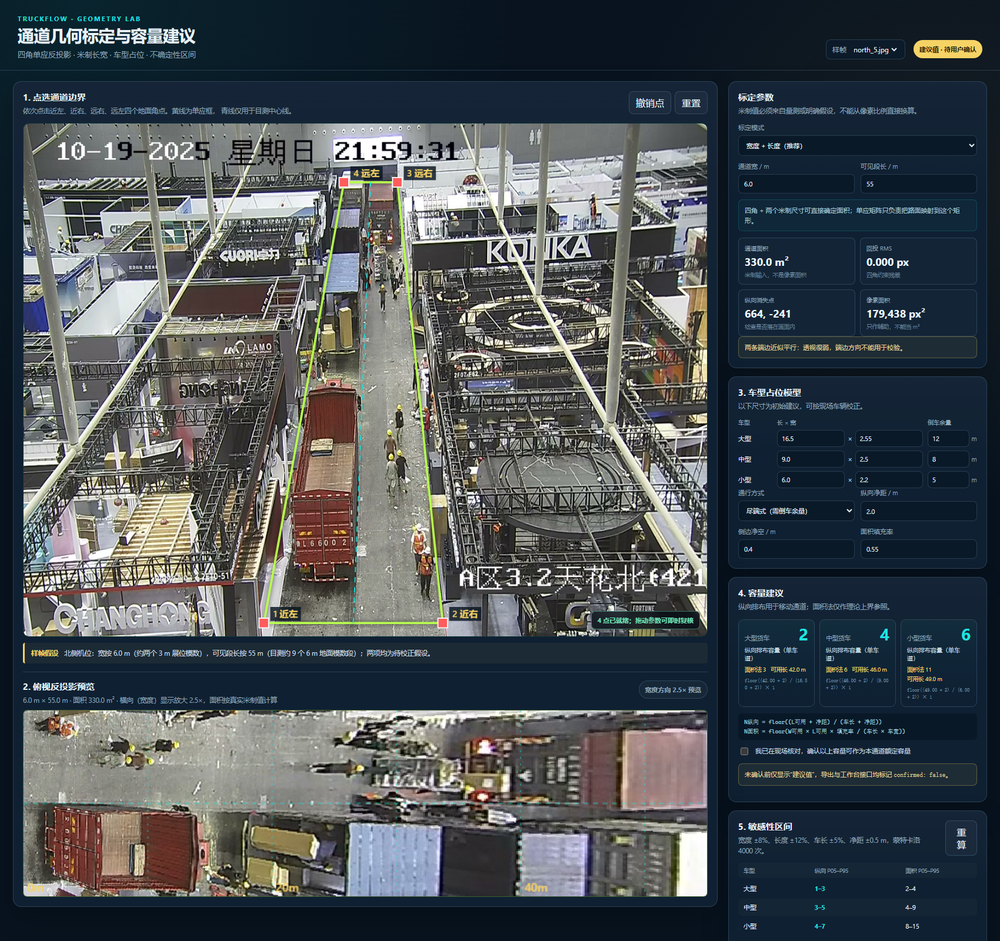
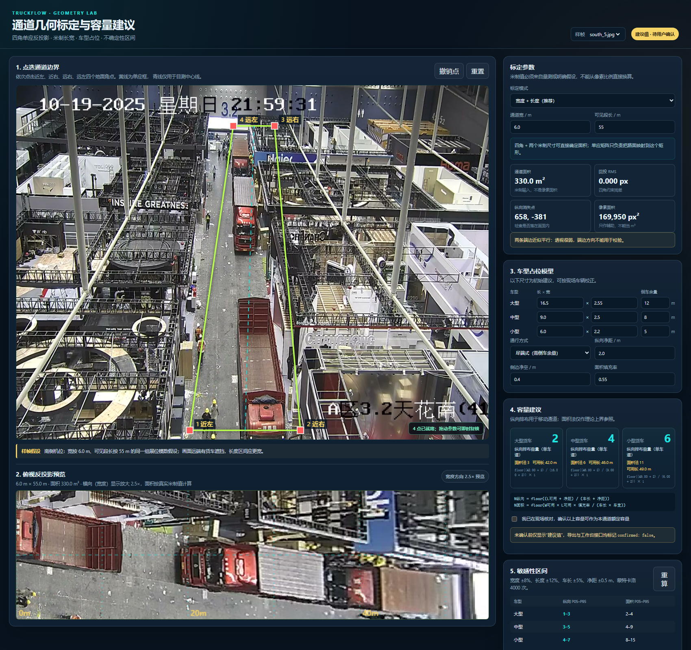
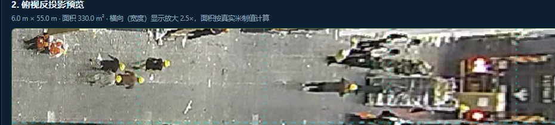
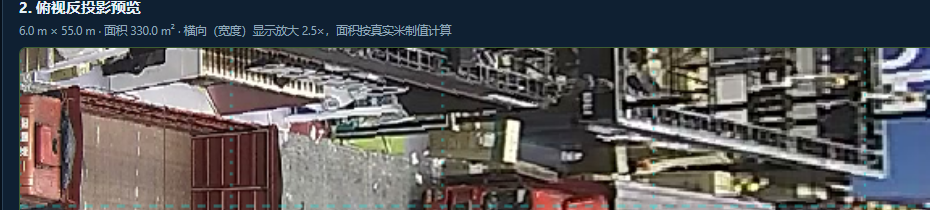

# 通道容量与透视几何研究

日期：2026-10-21  
分支：`research/capacity-geometry`  
范围：需求第 2 条的通道几何标定与容量建议。本文不做货车目标检测、跟踪或跨机位去重。

## 结论先行

1. 四角单应可以把画面中的梯形路面反投影成俯视矩形，但**四个角点加一个已知实长不能同时确定矩形的长和宽**。长宽比仍是一个自由度。本模块要求：

   - 推荐模式：同时输入通道宽度和可见段长度两个米制值；
   - 单维模式：输入一个已知边，并把长宽比作为显式假设，结果标记 `assumption-used`。

2. 以两张样帧、6.0 m × 55.0 m 的**示例假设**、尽端式通道计算，建议纵向容量为：

   | 车型 | 纵向建议 | 20,000 次蒙特卡洛 P05–P95 | 面积法参考 |
   |---|---:|---:|---:|
   | 大型 | 2 | 1–3 | 3 |
   | 中型 | 4 | 3–5 | 6 |
   | 小型 | 6 | 4–8 | 11 |

   这些是**建议值，不是用户确认的额定容量，也不是实测米制容量**。6.0 m 和 55.0 m 本身均为待校正假设。

3. 在长宽均直接输入的推荐模式下，角点误差、消失点不稳定和镜头畸变不会凭空改变 `W × L`；它们影响路面边界是否点对、车辆/区域在俯视图中的位置、以及用画面内标尺反推米制尺寸时的尺度。报告必须把“映射误差”和“容量输入误差”分开，不能把像素比例直接冒充米制尺寸。

## 1. 交付物

| 文件 | 内容 |
|---|---|
| `capacity.js` | 纯前端 UMD 模块：单应矩阵、反投影、消失点、容量模型、负载率、蒙特卡洛与误差分析 |
| `capacity.css` | 标定工作台样式 |
| `index.html` | 浏览器标定页：四角点选、米制输入、俯视预览、容量建议与确认门禁 |
| `test/capacity.test.js` | 15 条 Node 断言 |
| `analysis/run_samples.js` | 两张样帧的可复现实验 |
| `analysis/sample-results.json` | 实验机器可读输出 |
| `assets/north_calibration.png` | 北侧标定截图 |
| `assets/south_calibration.png` | 南侧标定截图 |
| `assets/north_topdown.png` | 北侧俯视反投影局部截图 |
| `assets/south_topdown.png` | 南侧俯视反投影局部截图 |

复现命令：

```powershell
node --test research/capacity_geometry/test/capacity.test.js
node research/capacity_geometry/analysis/run_samples.js
```

浏览器页面需要通过 HTTP 打开：

```powershell
python -m http.server 8899 --directory .
```

访问 `http://127.0.0.1:8899/research/capacity_geometry/index.html?preset=north`。

## 2. 四角标定与反投影

### 2.1 坐标约定

点击顺序固定为近左、近右、远右、远左。世界坐标以近左为原点，`x` 沿通道宽，`y` 沿通道长：

```text
(0,0)       (W,0)
   +-----------+   近端
   |  通道矩形  |
   +-----------+   远端
(0,L)       (W,L)
```

### 2.2 单应矩阵

给定 `(x_i,y_i) ↔ (u_i,v_i)` 四组对应点，求 `H`：

```text
[u]       [x]
[v] ~ H · [y]
[1]       [1]
```

每组点给出两行：

```text
x h11 + y h12 + h13 - u x h31 - u y h32 = u
x h21 + y h22 + h23 - v x h31 - v y h32 = v
```

实现使用 Hartley 归一化与 8×8 高斯消元求解 DLT。`H` 为“世界米制矩形 → 图像”，`H⁻¹` 为“图像 → 俯视米制平面”。四角回投残差必须小于 0.5 px，否则拒绝标定。

### 2.3 面积

俯视面积严格由米制矩形给出：

```text
A = W × L
```

像素多边形面积 `A_px` 只作诊断：

```text
A_px = 1/2 |Σ(x_i y_(i+1) - x_(i+1) y_i)|
```

`A_px` 不能乘一个全图统一的“米/像素”得到 `A`。北侧样例近端局部尺度约 0.0189 m/px，远端约 0.1158 m/px，相差约 6.1 倍。统一像素比例必然系统性高估或低估近/远端。

### 2.4 为什么一个已知边不够

四个角点提供 8 个坐标约束；单应矩阵有 8 个自由度。把目标矩形设为 `W × L` 时，长宽比是额外的形状参数。已知 `W` 只固定宽度刻度，`L` 仍然未知；已知 `L` 也同理。单应只会把用户选定的矩形精确映射到四个角，**不会从梯形比例中恢复真实长宽比**。

单维入口：

```js
TruckCapacity.calibrateFromReference({
  imagePoints,
  knownSide: "width",
  knownM: 6.0,
  aspectRatio: 9.17
});
```

返回：

```json
{
  "identifiability": {
    "status": "assumption-used",
    "explanation": "四个角点只能确定透视映射；已知一个长度不足以同时确定矩形的长和宽。"
  }
}
```

单维模式可用于“现场只有一条卷尺”的快速讨论，但长宽比必须显示为假设，并进入敏感性分析。

## 3. 浏览器标定页

页面提供四角点选、撤销、重置、两张样帧切换、米制输入、俯视反投影、车型占位、两种容量算法、敏感性和负载率。俯视预览按真实矩形生成，宽度方向显示放大 2.5× 仅用于可读性，面积不随显示放大改变。

北侧标定：



南侧标定：



北侧俯视局部：



南侧俯视局部：



顶部始终显示“建议值 · 待用户确认”。只有勾选“我已在现场核对”后，页面才在本地改成已确认；模块不把建议值冒充已核验额定容量。

## 4. 透视与广角误差

### 4.1 消失点

对边求交：

```text
左纵向边 ∩ 右纵向边 → V∥
近端横边 ∩ 远端横边 → V⊥
```

1280 × 960 样帧结果：

| 样帧 | 纵向消失点 | 3 px 角点抖动下 X P05–P95 | Y P05–P95 | 横向消失点 |
|---|---:|---:|---:|---|
| north_5 | (663.8, −241.1) | 658.0–669.1 | −276.5–−202.8 | 近于无穷远/极不稳定 |
| south_5 | (658.3, −381.5) | 651.7–664.3 | −432.9–−327.0 | 近于无穷远/极不稳定 |

纵向消失点位于画面外，方向与机位一致；X 抖动约 11 px，Y 抖动约 74–106 px。横向消失点因近/远端边几乎平行，轻微抖动可把它推到数万至数百万像素外，不能用于焦距反解。

针孔条件下，若主点为 `p`、焦距为 `f`，两个正交方向的消失点满足：

```text
(V∥ − p) · (V⊥ − p) + f² = 0
```

本样例 `V⊥` 不稳定，因此本模块**不用消失点反推米制长宽**。消失点只用于诊断角点顺序、四边形退化和透视稳定性，不直接决定容量数字。

### 4.2 镜头畸变

一阶径向畸变：

```text
r_undistorted = r_distorted × (1 + k1 r² + k2 r⁴ + ...)
```

局部尺度约为 `1 + k1 r²`，面积约乘 `(1 + k1 r²)²`。样例帧只有视频编码注释 `Lavc62.28.102`，没有焦距、主点或畸变系数，不能声称已做广角校正。

模块提供：

```js
TruckCapacity.distortionScaleSensitivity({
  k1Range: [-0.15, 0.05],
  maxNormalizedRadius: 1
});
```

作为**条件演示**，若把 `k1 ∈ [−0.15, 0.05]` 视为未知区间，并把横纵米制尺度都按 `s = 1 + k1` 缩放：

| k1（r=1） | s | 面积因子 s² | 纵向 L/M/S | 面积法 L/M/S |
|---:|---:|---:|---:|---:|
| −0.15 | 0.85 | 0.7225 | 1 / 3 / 5 | 2 / 4 / 8 |
| 0 | 1.00 | 1.0000 | 2 / 4 / 6 | 3 / 6 / 11 |
| +0.05 | 1.05 | 1.1025 | 2 / 4 / 6 | 4 / 7 / 13 |

该表说明未标定畸变会使容量按整数档位跳变，不是给这两台相机下结论。有镜头标定时应先对角点去畸变；没有标定时应放大长宽误差区间，不能把 `k1=0` 当已验证事实。

### 4.3 角点误差

| 样帧 | 近端 m/px | 3 px 地面偏移 | 远端 m/px | 3 px 地面偏移 |
|---|---:|---:|---:|---:|
| north_5 | 0.0189 | 约 0.057 m | 0.1158 | 约 0.347 m |
| south_5 | 0.0223 | 约 0.067 m | 0.0978 | 约 0.293 m |

3 px 高斯抖动、1,000 次重拟合后的世界坐标漂移 P95：

| 样帧 | 近左 | 近右 | 远右 | 远左 | 中心 |
|---|---:|---:|---:|---:|---:|
| north_5 | 0.140 m | 0.137 m | 1.289 m | 1.329 m | 1.203 m |
| south_5 | 0.165 m | 0.167 m | 1.045 m | 1.061 m | 1.099 m |

近端点偏 3 px 只差几厘米，远端点偏 3 px 可差几十厘米，再经过单应放大，中心区域可差约一米。这个误差必须用于车辆位置/区域判断；但在双维直接输入模式下，不应重复当成面积误差。

### 4.4 输入不确定性

`monteCarloCapacity()` 使用固定种子，采样：

| 参数 | 分布/范围 |
|---|---|
| 通道宽 | 均值 6.0 m，相对标准差 8% |
| 可见段长 | 均值 55.0 m，相对标准差 12% |
| 车长 | 相对标准差 5% |
| 车宽 | 相对标准差 2% |
| 纵向净距 | 2.0 m 附近，标准差 0.5 m |
| 倒车余量 | 相对标准差 15% |
| 面积填充率 | 0.55 附近，标准差 0.05 |

20,000 次结果：

| 车型 | 纵向 P05 / P50 / P95 | 面积法 P05 / P50 / P95 |
|---|---:|---:|
| 大型 | 1 / 2 / 3 | 2 / 3 / 4 |
| 中型 | 3 / 4 / 5 | 4 / 6 / 9 |
| 小型 | 4 / 6 / 8 | 8 / 11 / 15 |

容量取整数，区间不能显示成“2.0 辆很精确”。界面应同时显示基线建议与 P05–P95。

若当前大/中/小型各 1 辆：

```text
1/2 + 1/4 + 1/6 = 0.9167 = 91.7%
```

把容量取 P05 和 P95 时，负载率约在 65.8%–158.3% 之间。容量未确认前，负载率不能当作确定的业务结论。

## 5. 车型占位模型

### 5.1 建议尺寸

| 车型 | 占位长 × 宽 | 尽端式倒车余量 | 说明 |
|---|---:|---:|---|
| 小型 | 6.0 × 2.2 m | 5.0 m | 厢式轻卡/轻型货车 |
| 中型 | 9.0 × 2.5 m | 8.0 m | 两轴/三轴中卡 |
| 大型 | 16.5 × 2.55 m | 12.0 m | 重型牵引车/半挂 |

这些是初始占位，不是对所有车型的统计真值。用户应按现场最长/最宽车辆修正，尤其半挂后悬、货厢宽度与反光镜。

### 5.2 倒车余量

尽端式通道默认需要倒车余量，从可用长度扣除；直通式为 0。倒车余量是末端机动空间，不是每辆车之间的间距。样例：

```text
L_usable = 55 − 2×0.5 − 12 = 42 m
```

### 5.3 纵向排布容量

设车长 `l`、纵向净距 `g`、可用长度 `L_u`、车道数 `k`：

```text
N_long = floor((L_u + g) / (l + g)) × k
```

`N` 辆车需要 `N·l + (N−1)·g` 米，因此 `N ≤ (L_u+g)/(l+g)`。样例单车道：

```text
大型：floor((42.0 + 2.0) / (16.5 + 2.0)) = 2
中型：floor((46.0 + 2.0) / (9.0 + 2.0)) = 4
小型：floor((49.0 + 2.0) / (6.0 + 2.0)) = 6
```

### 5.4 面积利用率容量

```text
N_area = floor(W_u × (L − 2·c_end) × η / (l × w))
```

`W_u = W − 2·c_side`，`η=0.55`。该算法把通道当可铺满的停车场，不扣倒车余量，也不强制单车道、通道分隔和转弯空间，因此通常高于纵向排布，只能作为理论上界/对照。

样例：

```text
W_u = 6.0 − 0.8 = 5.2 m
大型：floor(5.2 × 54.0 × 0.55 / (16.5 × 2.55)) = 3
中型：floor(5.2 × 54.0 × 0.55 / (9.0 × 2.5)) = 6
小型：floor(5.2 × 54.0 × 0.55 / (6.0 × 2.2)) = 11
```

两种算法是口径差异，不是精度高低：纵向排布描述“车辆排成一条可撤离队列”，面积法描述“矩形铺满上界”。样帧是通行通道，建议默认使用纵向排布。

## 6. 两张真实样帧的标定

### 6.1 共同假设

样帧为 `north_5.jpg` 与 `south_5.jpg`，画面时间 2025-10-19 21:59:31。没有现场卷尺、展馆 CAD 或镜头标定，以下为**待校正假设**：

- 通道宽约 6.0 m：按两个约 3 m 展位模数；
- 可见段长约 55 m：按约 9 个 6 m 地面模数段。

这不是从像素比例直接推导的米制值，而是工作台默认假设。两张图使用相同 `W,L`，所以面积和容量相同；差异体现在角点、消失点和地面映射。

### 6.2 角点

顺序为近左、近右、远右、远左：

```text
north_5: (450,935) (785,935) (700,110) (600,110)
south_5: (470,935) (770,935) (700,110) (588,110)
```

北侧像素四边形面积 179,437.5 px²，南侧 169,950 px²；两者都不是米制面积。两者回投 RMS 在浮点误差量级（约 10⁻¹³ px），因为四点 DLT 本来就把四个角精确映射到目标矩形。

### 6.3 容量结果

统一参数：宽度 6.0 m、长度 55.0 m；尽端式，大型 12 m、中型 8 m、小型 5 m 倒车余量；纵向净距 2.0 m；侧边净空 0.4 m/侧；端部净空 0.5 m/端；面积填充率 0.55；单车道。

| 车型 | 纵向建议 | 面积法参考 | 纵向 P05–P95 | 面积法 P05–P95 |
|---|---:|---:|---:|---:|
| 大型 | 2 | 3 | 1–3 | 2–4 |
| 中型 | 4 | 6 | 3–5 | 4–9 |
| 小型 | 6 | 11 | 4–8 | 8–15 |

两张样帧容量相同，是因为输入长宽相同；这不是两次独立测量互相印证。它们独立验证的是同一套标定流程可在北/南视角生成可读的反投影和合理的地面消失点。

### 6.4 校准确认状态

页面默认 `confirmed:false`，顶部显示“建议值 · 待用户确认”。只有用户勾选现场核对后，页面才在本地改成已确认；本模块不把确认写入后端。

## 7. 负载率

严格使用产品规格公式：

```text
R = N_L / C_L + N_M / C_M + N_S / C_S
```

```js
const result = TruckCapacity.loadSummary(
  { large: 1, medium: 1, small: 1 },
  { large: 2, medium: 4, small: 6 }
);
// result.totalRatio = 0.9167
```

边界：

- `C_i=0,N_i=0`：该项记 0；
- `C_i=0,N_i>0`：结果 `invalid`，不返回被压成 0 的假负载率；
- 合计可超过 100%，界面保留超载语义，不截断。

容量建议和负载率都必须带相同确认状态；未确认时展示区间，不展示单一“额定值”。

## 8. 工作台接入

`capacity.js` 是 UMD 模块，浏览器全局名 `TruckCapacity`，Node 通过 `require` 使用，无第三方依赖。

```js
const cal = TruckCapacity.calibrate({
  imagePoints: [nearLeft, nearRight, farRight, farLeft],
  widthM: 6.0,
  lengthM: 55.0,
  imageSize: { width: 1280, height: 960 }
});

const cap = TruckCapacity.computeCapacities({
  widthM: cal.widthM,
  lengthM: cal.lengthM,
  model: {
    trafficMode: "dead-end",
    longitudinalGapM: 2.0,
    sideClearanceM: 0.4,
    endClearanceM: 0.5,
    areaFillFactor: 0.55
  }
});
```

建议对象：

```json
{
  "type": "geometry-capacity-suggestion",
  "version": 1,
  "dimensions": {
    "widthM": 6.0,
    "lengthM": 55.0,
    "method": "assumed",
    "assumptionNote": "展位模数，待现场校正"
  },
  "capacities": {
    "large": { "longitudinal": 2, "area": 3, "p05": 1, "p95": 3 },
    "medium": { "longitudinal": 4, "area": 6, "p05": 3, "p95": 5 },
    "small": { "longitudinal": 6, "area": 11, "p05": 4, "p95": 8 }
  },
  "recommendedAlgorithm": "longitudinal",
  "confirmed": false
}
```

工作台必须同时展示 `method:"assumed"`、`confirmed:false` 和 P05–P95；只显示“2/4/6”会丢失关键前提。

## 9. 验证

`node --test research/capacity_geometry/test/capacity.test.js` 当前 **15/15 通过**，覆盖：

- 单应四点精确映射与逆变换往返；
- 米制面积与像素面积不混用；
- 单维 + 长宽比标记 `assumption-used`；
- 非凸/交叉角点拒绝；
- 纵向容量、面积容量、直通/尽端差异；
- `Σ(N_i/C_i)` 精确计算；
- 零容量 + 非零车辆返回 `invalid`；
- 蒙特卡洛固定种子可复现、分位数有序；
- 角点抖动不伪造面积不确定度；
- 径向畸变区间；
- 局部米/像素尺度；
- 消失点对点选误差的散布。

浏览器冒烟检查：`?preset=north&capture=1` 和 `?preset=south&capture=1` 均渲染 330.0 m²、容量卡片、敏感性表，顶部保持“建议值 · 待用户确认”。

## 10. 限制与下一步

1. 6.0 × 55.0 m 是假设，不是测量；用户校正前容量只能作为讨论稿。
2. 没有镜头标定，广角畸变未实际去除；四角单应只保证四个角。
3. 没有相机焦距/主点，不能由消失点反解米制尺寸。
4. 容量是静态几何估计，不是吞吐量、排队时间或高峰预测。
5. `Σ(N_i/C_i)` 是产品规定的管理指标，不证明任意混合车型都物理上能放入同一通道。
6. 没有目标检测；车辆位置只供人眼复核。

提高可信度的优先顺序：

1. 用卷尺或展馆 CAD 测通道宽度、可见段长度，至少各测两次；
2. 记录相机型号/焦距/主点，做棋盘格或直线标定得到 `k1,k2`；
3. 由现场确认直通/尽端与倒车余量；
4. 确认大型车最长占位，尤其半挂后悬与货厢宽度；
5. 用户点击“已核对”后，才把建议写入工作台额定容量；否则保留区间与 `confirmed:false`。
