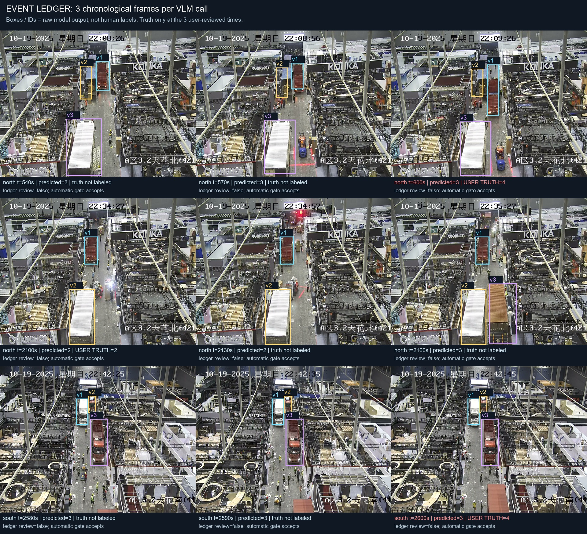

# Event ledger route v1 — reject as automatic counting replacement

## Decision

Keep the deterministic evidence-bound ledger as an optional integrity component; **do not promote this seeded three-frame VLM architecture into automatic counting**. Three requests succeeded, yet two of three user-reviewed counts were wrong and both passed the ledger's automatic gate. Persistent visual omission cannot be repaired by an internally consistent identity/event history alone.

This is an independent architectural exploration, not another round of prompt retries. It uses no conventional detector/tracker and no per-vehicle model queries. Only three new VLM requests were made; no response was retried or selected after observing labels. Main code and gold labels are untouched.

## Frozen experiment and provenance

Branch: `research/event-ledger-v1`, base main `33a2cfea70cdd4ed4addc7ea13e5c6ffeb8d6e74`.

Each request sees three chronological, full-resolution 1280×960 frames from the authorized data foundation, plus fallible old-model candidates from the first frame. The model must correct missed/merged seeds, supply current-frame boxes/evidence, stable local IDs, and entered/exited/still_visible/occluded/reappeared/seed_corrected events. The ledger derives visible counts from current observations, not from a carried-forward number.

| Frozen window | Purpose | User-reviewed target |
|---|---|---|
| north 540 / 570 / 600 seconds | Distant-body omission/merge | north 600 |
| north 2100 / 2130 / 2160 seconds | Potential entry event | north 2100 |
| south 2580 / 2590 / 2600 seconds | Partially visible bottom-edge cargo | south 2600 |

Source videos: `D:\File\PROJECT\数据底座\数据底座-货车\视频\A区天花北.mp4` and `A区天花南.mp4` in the same directory. FFmpeg selected frames at the stated seconds; the manifest records frame indices at 25 fps and SHA-256 hashes. Model: configured Doubao endpoint `ep-20260828174616-dthpx`, temperature 0, max_tokens 5000. Prompt and complete raw responses are retained.

The only count truth used for evaluation is the public `accuracy/reviewed/user-final-review-v2-2026-10-21.json`. User truth, review pictures/boxes, and expected counts are **never model inputs**. These three points are reused development samples, not an independent holdout. Old `data/gold/camera_counts_v0.json` and `data/manual_review_v1.json` are AI-provisional, not human ground truth.

The bootstrap candidates reuse three existing inference outputs from public `data/timeline_camera_v1.json`. They are explicitly described to the model as fallible. Their original calls, tokens and latency are not included in the new experiment cost.

## Count results

Fixed planned N=3, valid N=3, successful requests=3, failed requests=0.

| Point | User truth | Event ledger | Pure aisle baseline | Ledger review |
|---|---:|---:|---:|---|
| north 600 | 4 | 3 | 2 | false |
| north 2100 | 2 | 2 | 2 | false |
| south 2600 | 4 | 3 | 4 | false |

- Event route: **1/3 exact**, MAE **0.667**, undercounted units **2**, overcounted units **0**.
- Same-point pure aisle baseline: **2/3 exact**, MAE **0.667**, undercounted units **2**, overcounted units **0**.
- Automatic acceptance: coverage **3/3**, accepted correct **1**, **accepted wrong 2**; accepted accuracy **1/3**. This gate is unsafe.
- All nine snapshots had no uncertainty/review flags; all passed schema and ledger checks. These checks establish consistency, not perceptual correctness.

The baseline is read from the public `accuracy/runs/aisle_doubao/{camera}_{time}_aisle.json` files, not a mixed grid/crop timeline. Do not compare this targeted 1/3 directly against the full baseline's 16/20; the sample sets differ. North 2100 is a retrospective result: the request also sees 2130 and 2160. It is not evidence of causal streaming accuracy at 2100.

## What failed and what remains unknown

North far-window counts were `[3,3,3]`: the model consistently represented the far blue body area as one vehicle. It improved north 600 over the aisle baseline's count 2 but still missed one user-confirmed vehicle. South boundary-window counts were `[3,3,3]`: the partial bottom-edge fourth vehicle was not discovered, despite neighboring frames. All events there were `still_visible`.

The entry window produced `[2,2,3]` and one `entered` event at 2160. Its evidence was merely "newly appeared ... not present in 2130", weaker than the prompt's requirement of visible physical boundary crossing. No user labels exist for the 2130/2160 counts or event/identity correctness, so **event accuracy and ID accuracy are unmeasured**. A structurally legal event is not verified physical motion. Cross-camera uniqueness, size/type classification and full-video counting accuracy are also unmeasured.

The first frame seed can anchor interpretation. This small design does not isolate whether failure comes from seed bias, limited scale, temporal sampling, or underlying model recall. Claims that memory improves recognition would be unsupported here.

## Performance and accounting

| Window | New calls / images | API latency | Total tokens | Frame-span wait |
|---|---:|---:|---:|---:|
| north far | 1 / 3 | 27.680 s | 8,298 | 60 s |
| north entry | 1 / 3 | 30.202 s | 8,207 | 60 s |
| south boundary | 1 / 3 | 94.273 s | 7,892 | 20 s |

Total new usage: **3 requests, 9 image inputs, 24,397 tokens**. Mean API latency **50.718 s**, empirical p95 **94.273 s** (N=3, thus the maximum), summed serial latency **152.155 s**. The experiment submitted three windows concurrently with three workers; per-request latency is not equal to end-to-end single-stream latency.

One request serves three frames, or 1/3 new request per input frame. This is **not** proof of lower image/token cost than single-frame calls. Real-time operation must include the 20/60 second frame-aggregation wait, any live bootstrap inference, and inference latency. For north 2100, output is delayed by at least 60+30.202=90.202 seconds from that target image. Memory storage and ledger replay are inexpensive relative to VLM inference, but no production throughput benchmark was run.

## Prototype and verification

`src/ledger.py` prevents ghost counts: exited/occluded observations are not currently visible; absent vehicles without events become unresolved and require review; each visible identity requires a current-frame normalized box and visible evidence. It flags duplicate IDs, unknown reappearance, impossible transitions, unexplained disappearance, and total/list disagreement. Five meaningful local tests pass. These safeguards do not detect a vehicle never perceived at all.

Reproduce without API calls from this worktree:

```powershell
python research/event_ledger/test_ledger.py
python research/event_ledger/run_experiment.py --offline
python research/event_ledger/render_evidence.py
```

`--offline` reads cached responses only and fails if any cache is absent. Full experiment mode uses the configured public `.env` silently, never commits credentials, and skips already-cached calls. Source videos are not redistributed; the nine hashed extracted evidence frames are included.



## Continue / stop recommendation

1. Stop this exact seeded three-frame counting route; it is less reliable than the same-point baseline and adds latency.
2. Retain ledger mechanics only behind an independently validated perceptual stage. `review=false` must not be treated as certified correctness.
3. If exploring a successor, change available evidence rather than repeatedly asking the same model to reconsider the same image: scale/view diversity, seed-free independent recall, or other independent candidate generation. Compare such a route under a frozen call/image budget and the same review truth, then validate on a new holdout.
4. For identity-memory claims, first obtain a small explicitly user-reviewed event/identity sequence. Count labels alone cannot prove stable vehicle identities or entering/exiting events.
